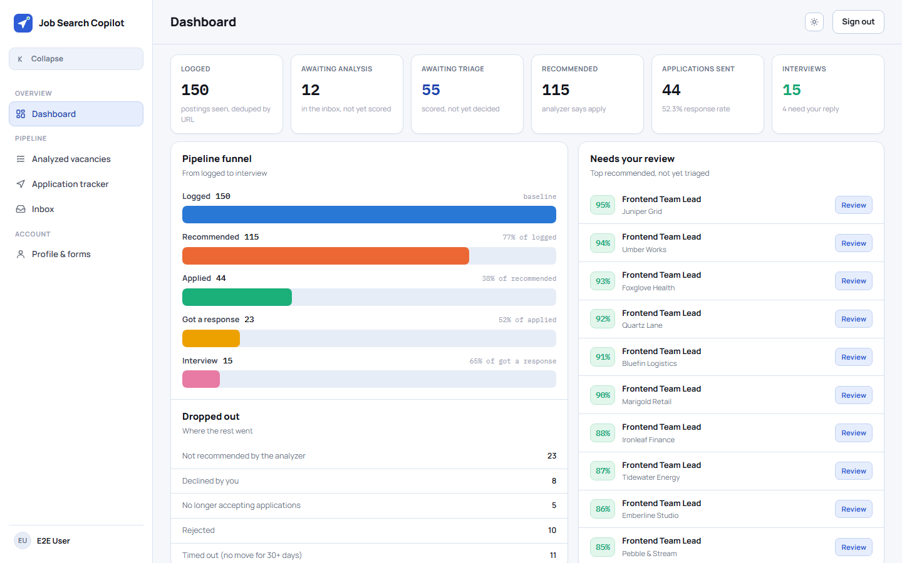
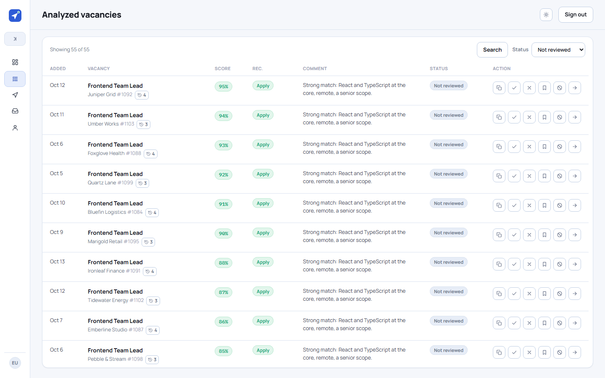
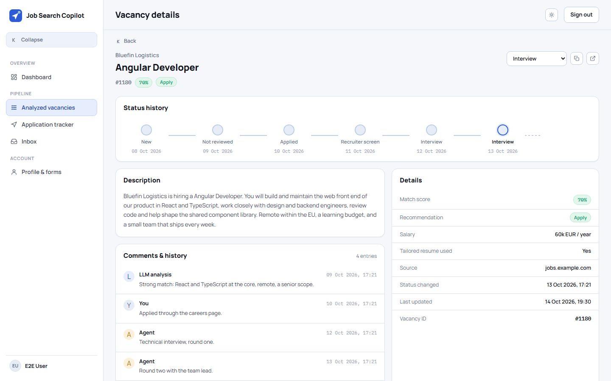
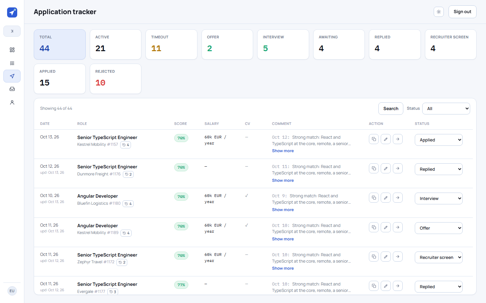
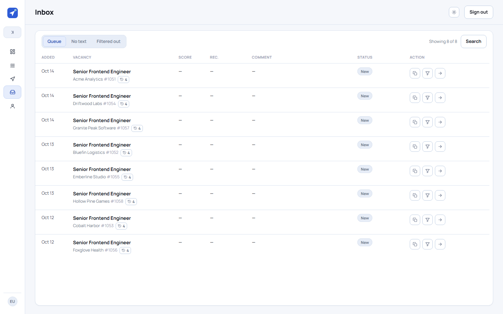

# Job Search Copilot

A personal tool for running a job search. Vacancies come in from job boards and
recommendation emails, or straight from a chat with Claude. Claude scores each one
against my profile (a match score, a recommendation and a short review), and this app
keeps them: one place to triage what is worth applying to, and to follow each
application from *applied* to an offer or a rejection.

**This is an early MVP, and it is still being written.** For now it covers what my own
job search needs right away: keeping vacancies, triaging them and tracking
applications. The analysis happens in Claude; the app organises, tracks and lets me
review fast. New parts come as I need them — see the [roadmap](#roadmap).

<picture>
  <source media="(prefers-color-scheme: dark)" srcset="docs/screenshots/dashboard-dark.png">
  
</picture>

<details>
<summary>More screens</summary>

**Analyzed vacancies** — score, recommendation and the review, with one-click triage.

<picture>
  <source media="(prefers-color-scheme: dark)" srcset="docs/screenshots/vacancies-dark.png">
  
</picture>

**One vacancy** — the status history, the posting, comments from me and from Claude.

<picture>
  <source media="(prefers-color-scheme: dark)" srcset="docs/screenshots/vacancy-dark.png">
  
</picture>

**Application tracker** — every application by pipeline stage, with the ones gone quiet
for 30 days.

<picture>
  <source media="(prefers-color-scheme: dark)" srcset="docs/screenshots/applications-dark.png">
  
</picture>

**Inbox** — new vacancies waiting for Claude to score them.

<picture>
  <source media="(prefers-color-scheme: dark)" srcset="docs/screenshots/inbox-dark.png">
  
</picture>

</details>

All the data in the screenshots is made up.

## How it works

Vacancies get in two ways:

```
 1. Collected                              2. From a chat with Claude
 job boards, recommendation emails         a link, a posting or a whole list
          │ n8n workflows                           │ Claude scores it right in the chat
          ▼                                         ▼
 POST /api/v1/vacancies/intake             MCP: save_vacancy / save_vacancies_batch
 with an API key; lands unscored (NEW)     lands already scored
          │                                         │
          ▼                                         │
 Claude, over MCP: picks up the NEW ones,           │
 scores them, submits the analyses                  │
          │                                         │
          └────────────────────┬────────────────────┘
                               ▼
              PostgreSQL, through packages/core only
                               ▼
              Web app: triage — apply, decline, save for later
                               ▼
              Application pipeline: applied → replied → recruiter screen → interview → offer
              (Claude can move a status when a reply email comes in)
```

A vacancy has two independent fields: the **recommendation** is Claude's opinion and
never changes after the analysis; the **status** is mine. A vacancy is analysed once.
More in [`docs/domain-model.md`](docs/domain-model.md).

Two parts live outside this repo, because they hold personal data and are set up by
hand: the n8n workflows that collect vacancies, and the Claude skills that score them
against my profile. Anything that can call the REST API with a key, or talk MCP, can
feed the app instead.

## Features

- **Dashboard** — counters, a funnel from logged to interview, where the rest dropped
  out, and the top recommended vacancies not yet reviewed.
- **Vacancy tables** — infinite scroll, search, status filters, one-click triage, and
  a company's other vacancies in a modal.
- **Application tracker** — pipeline stages, salary and tailored-CV notes, comments,
  and a 30-day timeout for applications nobody answered.
- **MCP server** — 15 tools, so Claude can save vacancies scored in a chat, read the
  queue, submit analyses, record applications and move statuses. Over stdio, or Streamable HTTP with OAuth 2.1.
- **REST API** — documented with Swagger UI; every route closed unless marked
  otherwise.
- **Sign-in** — Google, LinkedIn or a passkey; sign-up limited to an allowlist.
- **Several users** — each sees only their own vacancies; per-user API keys for n8n and
  MCP.
- Light and dark theme; works on a phone.

## Architecture

An npm-workspaces monorepo:

| Package | What it is |
| --- | --- |
| [`packages/core`](packages/core/README.md) | The domain layer and the only database client: Prisma schema and migrations, the services, the status rules, auth (Better Auth) and API keys. |
| `apps/api` | NestJS REST API (`/api/v1`) for the web app and n8n. |
| `apps/mcp` | The MCP server: the same services as tools, over stdio and Streamable HTTP. |
| `apps/web` | React SPA: dashboard, tables, the vacancy page, the inbox, the profile. |

```
n8n ─────────▶ apps/api ◀── apps/web
                  │
Claude ──▶ apps/mcp ─┴─▶ packages/core ──▶ PostgreSQL
```

Stack: TypeScript, Node 24, PostgreSQL 17, Prisma 7, NestJS 12, React 19, Vite,
Tailwind, TanStack Router and Query, zod, Better Auth, the MCP TypeScript SDK; Vitest
and Playwright for tests; Biome; Docker Compose; GitHub Actions.

The system map is in [`docs/architecture.md`](docs/architecture.md).

## Quick start

```bash
cp .env.example .env            # then fill in the auth values
npm install && npm run generate
docker compose up -d
npm run migrate:dev
```

Then open http://localhost:5173. Signing in needs a Google or LinkedIn OAuth client and
your email in `AUTH_ALLOWED_EMAILS`. The full guide — test databases, the MCP server,
API keys, every script — is in [`docs/development.md`](docs/development.md).

## How it's built

I build this with [Claude Code](https://claude.com/claude-code) as a pair programmer.
The repo is set up so an AI agent can work on it for weeks without losing the thread:

- **Phases and steps.** Each phase has a plan in [`docs/phases/`](docs/phases/), split
  into steps that can be finished and checked one at a time. One step per session; the
  step brings its own tests and is ticked only after the full test suite passes in that
  session.
- **Decisions on record.** Every decision that other code depends on is an ADR in
  [`docs/decisions/`](docs/decisions/), ending with *what breaks if you change it*.
- **Invariants that break silently** are listed in
  [`docs/architecture.md`](docs/architecture.md#system-invariants), with tests where a
  test can guard one — for example, a test that fails if any vacancy query skips the
  owner filter.
- **Chained steps.** Several steps can run in a row, each in a fresh subagent, while
  the main session reviews and commits.
- **Real tests.** Integration tests against a real PostgreSQL, no Prisma mocks; a
  contract test between the web and the API; Playwright over every screen.
- **No personal data.** Tests, the seed and these screenshots use made-up companies, and
  a git hook blocks a commit or a push that carries my real data.

The rules the agent follows are in [`CLAUDE.md`](CLAUDE.md).

## Roadmap

- **Deploy** to a small VPS with HTTPS, so claude.ai can reach the MCP server and the
  n8n intake runs around the clock.
- **A public demo** on the made-up seed, reset every night.
- **A real profile page** — the candidate profile and master resumes in the app, then
  tailoring a resume from a vacancy page.
- **Collectors inside the app**, instead of hand-built n8n workflows.
- **A company exclusion list** and company aliases.
- A UI for the status journal, per-column filters, live updates.

The full list: [`docs/backlog.md`](docs/backlog.md).

## License

MIT — see [LICENSE](LICENSE).
